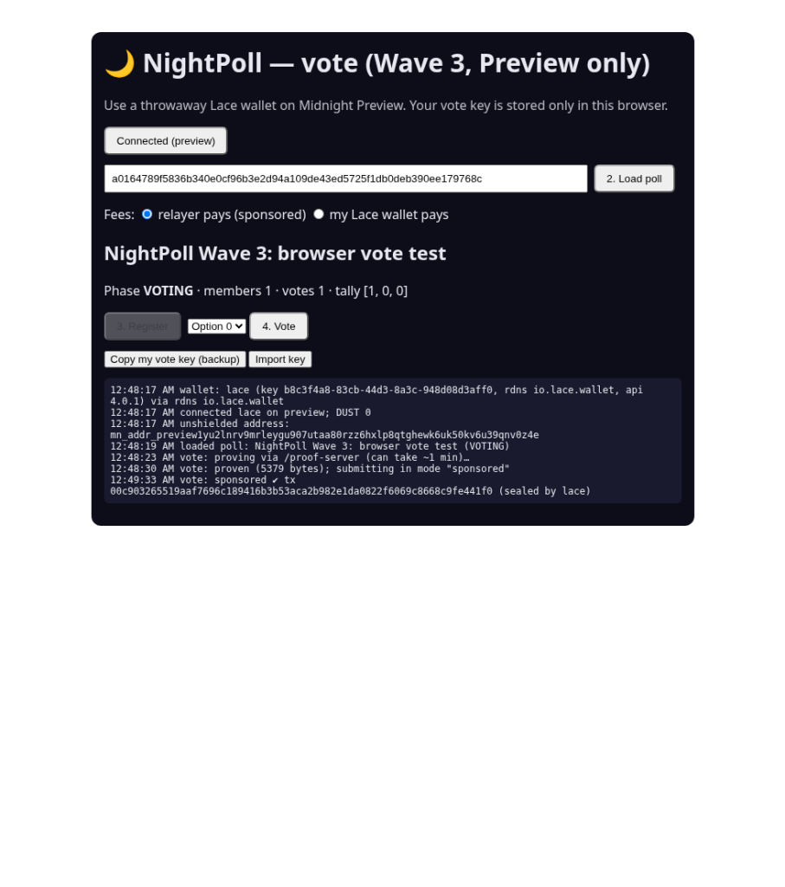
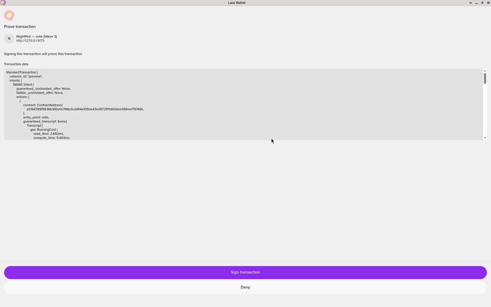

# Wave 3 results: sponsored voting with real Lace on Midnight Preview

Date: 2026-10-13 (JST). Network: Midnight **Preview**. Wallet: a throwaway Lace wallet with **0 DUST**.
Poll: `a0164789f5836b340e0cf96b3e2d94a109de43ed5725f1db0deb390ee179768c` (the Wave 2 demo poll `03aa4564…` was not touched).

## What happened
1. **Register (sponsored).** The page proved `register` through the local proof server. Lace sealed it with
   `balanceUnsealedTransaction(…, {payFees:false})`, and the live relayer added DUST fees and submitted it.
   Tx `003834870040feb389a944c1cc163ce87e1dd6c15284c6b2bc5b6a93221a844bb8`, block 1266245.
2. **openVoting (admin, CLI).** Tx `0060623adcd64483a68a7dc52c8d07100390b364414f2150be4627ca08a9716415`, block 1266664.
3. **Vote option 0 (sponsored).** Lace's "Prove transaction" popup showed `network_id: "preview"`, entry point
   `vote` and the poll contract. Proof: 5379 B. The relayer submitted it.
   Tx `00c903265519aaf7696c189416b3b53aca2b982e1da0822f6069c8668c9fe441f0`. Tally afterwards: `[1, 0, 0]`.
4. **Duplicate vote.** It failed while proving, with `failed assert: NightPoll: already voted`. No Lace popup
   appeared and nothing was submitted.

## Fixes after the run
- **Vote button stays enabled after voting.** The page now computes `voteNullifier(pollId, sk)` locally (with the
  contract's pure circuit) and checks it against the public `nullifiers` set. It does this on connect, on load,
  before proving a vote, and after a successful vote. If the nullifier is there, the Vote button is disabled and
  an "already voted" note is shown. The secret is used only as an input to the local hash.
- **First Connect click after a hard refresh does nothing.** On a hard refresh, Lace's content script can inject
  `window.midnight` after the page has rendered. A wallet `connect()` that never settles also left no trace in the
  page log. Connect now reads `window.midnight` lazily and polls for it for up to 3 s. It logs each step, and a
  `connect()` / `getConfiguration()` call that doesn't answer becomes a visible error.

## M5 live rerun: jitter + mixing window (2026-10-15 JST, Preview)

New throwaway test poll `5f7a1ac18c6a06515c9ce88a8fc24cba9cde9fdcc173ad7c287f0cca975b8d5c` (3 options, self-registration;
deploy tx `0012c31aaa89c6208d99ed0a99595f7fe667723818eb10d54ec553680778a9b8c4`, block 1298417). The Wave 2 poll `03aa4564…`
and the M3/M4 poll `a0164789…` were not touched.

Relayer: `npm run relayer -w @nightpoll/cli` with `NP_RELAYER_JITTER_MS=6000 NP_RELAYER_BATCH_MS=15000 NP_RELAYER_BATCH_MAX=8
NP_RELAYER_PER_CLIENT=20` (the per-client limit was raised only because all test members share one host).
Members: 3 fresh keys with **no wallet at all**, driven by the new `npm run rerun:voters -w @nightpoll/cli` helper
(`cli/src/relayer/rerun-voters.ts`). Each member builds and proves locally, seals with `tx.bind()` (a NightPoll call moves no
value), and all three POST to the relayer at the same moment.

| Step | Sent (member order) | Relayer submitted (order) | Tx ids |
|---|---|---|---|
| register ×3 | 0, 1, 2 at t=0 | 1 (41.8 s), 0 (66.2 s), 2 (83.8 s) | `001d878c…f0c4`, `001bef95…cd91`, `003e81bc…a870` |
| openVoting (admin, CLI) | | | `002f4f6b33ccc5355df6cc7b4e69d5063115d8113cc63151c3f663d24d2c4f3155`, block 1298471 |
| vote ×3 (choices 0, 2, 2) | 0, 1, 2 at t=0 | 1 (40.4 s), 0 (63.7 s), 2 failed (71.0 s) | `004819d3…f507`, `00e6a247…6a86` |
| vote retry, member 2 (re-proved) | 2 | 2 (41.8 s) | `002f094f1549cc3292bccab43295ab14062cb9869605a86ce261de987c1d7959cd` |

Final ledger: phase VOTING, 3 members, 3 votes, tally `[1, 0, 2]`. A second vote from an existing member fails while
proving with `failed assert: NightPoll: already voted`. The relayer log has no client IPs (only tx ids and errors).

What this shows:
- **Mixing window works on a live network.** Three requests that arrived together were submitted as 1, 0, 2 both times, so the
  on-chain order does not follow the request order. Every request waited at least the 15 s window plus jitter.
- **Throughput cost is real.** Submission stays serialized (one DUST spend at a time), so with ~20 s per submit the last of three
  members waited ~70–84 s. That is the price of not double-spending the sponsor's DUST.
- **Found: a vote proven before earlier votes land can be rejected.** The third vote failed at the node with
  `1010: Invalid Transaction: Custom error: 104`. Re-proving it against the updated state and resending succeeded. Likely cause:
  the vote's proof/transcript was built on contract state that two other votes had already changed by the time it was
  submitted (the registers did not hit this). Follow-up: the relayer should return a distinct "stale, re-prove" error for 104,
  and the page should re-prove and resend once automatically. **Done (follow-up commit):** the relayer now answers 104 with
  `409 { code: "STALE_PROOF", retryable: true }` and gives back the rate-limit slot and daily budget (nothing was spent); the
  vote page shows 「证明已过期，请重新生成」, re-reads the poll, rebuilds + re-proves and resends exactly once (wallet mode too,
  when Lace surfaces the 104). A second stale rejection is shown to the user instead of looping. Unit-tested
  (`cli/src/test/relayer-stale.test.ts`, `ui/src/vote/test/stale-proof.test.ts`); not yet re-run live on Preview.
